<p align="center">
  
</p>

<div align="center">
<a href="../../README.md">English</a>
&nbsp;&nbsp;| &nbsp;&nbsp;
<a href="README-es.md">Español</a>
&nbsp;&nbsp;| &nbsp;&nbsp;
<a href="README-zh_Hans.md">简体中文</a>
&nbsp;&nbsp;| &nbsp;&nbsp;
繁體中文
&nbsp;&nbsp;| &nbsp;&nbsp;
<a href="README-ar.md">العربية</a>
&nbsp;&nbsp;| &nbsp;&nbsp;
<a href="README-pt_BR.md">Português (Brasil)</a>
&nbsp;&nbsp;| &nbsp;&nbsp;
<a href="README-fr.md">Français</a>
&nbsp;&nbsp;| &nbsp;&nbsp;
<a href="README-de.md">Deutsch</a>
&nbsp;&nbsp;| &nbsp;&nbsp;
<a href="README-ru.md">Русский</a>
&nbsp;&nbsp;| &nbsp;&nbsp;
<a href="README-ja.md">日本語</a>
&nbsp;&nbsp;| &nbsp;&nbsp;
<a href="README-id.md">Bahasa Indonesia</a>
&nbsp;&nbsp;| &nbsp;&nbsp;
<a href="README-hi.md">हिंदी</a>
&nbsp;&nbsp;| &nbsp;&nbsp;
<a href="README-ur.md">اردو</a>
&nbsp;&nbsp;| &nbsp;&nbsp;
<a href="README-uk.md">Українська</a>
&nbsp;&nbsp;| &nbsp;&nbsp;
<a href="README-th.md">ภาษาไทย</a>
&nbsp;&nbsp;| &nbsp;&nbsp;
<a href="README-fa.md">فارسی</a>
&nbsp;&nbsp;| &nbsp;&nbsp;
<a href="README-it.md">Italiano</a>
&nbsp;&nbsp;| &nbsp;&nbsp;
<a href="README-az.md">Azərbaycanca</a>
&nbsp;&nbsp;| &nbsp;&nbsp;
<a href="README-sr.md">Српски</a>
</div>
<br> <!-- Adds vertical space here -->
<div align="center">

[](https://github.com/SibtainOcn/Hazel/releases/latest)
[](https://github.com/SibtainOcn/Hazel/releases/latest)


[](https://github.com/SibtainOcn/Hazel/stargazers)

[](https://github.com/SibtainOcn/Hazel/blob/main/LICENSE)
[](https://github.com/SibtainOcn/Hazel/releases/latest)
[](https://github.com/SibtainOcn/Hazel/blob/main/CHANGELOG.md)
[](https://github.com/SibtainOcn/Hazel/releases)
[](https://github.com/yt-dlp/yt-dlp/blob/master/supportedsites.md)

</div>

<p align="center">
  <a href="https://sibtainocn.github.io/Hazel/hazel/"><b>🌐 官網</b></a> &nbsp;•&nbsp;
  <a href="https://github.com/SibtainOcn/Hazel/releases/latest"><b>⬇️ 下載</b></a> &nbsp;•&nbsp;
  <a href="https://github.com/SibtainOcn/Hazel/wiki"><b>📖 Wiki</b></a> &nbsp;•&nbsp;
  <a href="https://sibtainocn.github.io/Hazel/hazel/guide.html"><b>🧭 指南</b></a> &nbsp;•&nbsp;
  <a href="https://sibtainocn.github.io/Hazel/hazel/faq.html"><b>❓ 常見問題</b></a>
</p>

---
## 💚 喜歡 Hazel？給它一點愛

如果 Hazel 對你有幫助，歡迎支持它的開發。你的支持能幫助我持續改進 Hazel 並開發新功能。每一份心意都意義非凡。

<div align="center">
<table>
  <tr><th align="center">☕ 一次性支持</th><th align="center">🤝 長期贊助</th></tr>
  <tr>
    <td align="center"><a href="https://www.buymeacoffee.com/sibtainocean"></a></td>
    <td align="center"><a href="https://github.com/sponsors/SibtainOcn"></a></td>
  </tr>
</table>

<sub>支持從不是必須的，也不會解鎖任何內容。所有功能對所有人永久免費。沒有餘錢？<a href="https://github.com/SibtainOcn/Hazel/stargazers">給儲存庫按個 Star</a> 或 <a href="https://github.com/SibtainOcn/Hazel/issues/new/choose">回報問題</a>，同樣很有幫助。</sub>
</div>

---
## ✨ 為什麼選擇 Hazel？

Hazel 是一款由 **yt-dlp** 驅動的免費開源 Android 下載器。從 **1500+ 個網站** 儲存影片、音樂和播放清單，無廣告、無追蹤、無需帳號。

<table>
  <tr><th width="50%" align="left">📥 下載</th><th width="50%" align="left">🔍 搜尋與播放</th></tr>
  <tr><td><b>1500+ 個網站：</b>YouTube、Instagram、TikTok、X、Reddit、SoundCloud 及<a href="https://github.com/yt-dlp/yt-dlp/blob/master/supportedsites.md">更多</a>。</td><td><b>搜尋：</b>YouTube、YouTube Music、SoundCloud 或 Bandcamp，可選搜尋建議。</td></tr>
  <tr><td><b>批次：</b>一個連結、多個連結或整個播放清單 / 頻道。</td><td><b>先播放：</b>在卡片上直接播放任何結果，支援拖曳進度、雙擊快轉和全螢幕。</td></tr>
  <tr><td><b>Hazel Instant：</b>從任何 App 分享連結，即依已儲存的畫質開始下載。</td><td><b>剪輯：</b>在即時預覽中選取，只儲存你想要的部分。</td></tr>
  <tr><td><b>你的格式：</b>選擇畫質、容器、音軌，並編輯標題 / 中繼資料。</td><td><b>直播：</b>從頭錄製，或等待首播。</td></tr>
</table>

<table>
  <tr><th width="50%" align="left">⚙️ 處理與下載</th><th width="50%" align="left">🔒 隱私與個人化</th></tr>
  <tr><td><b>SponsorBlock：</b>移除贊助、片頭等片段。</td><td><b>無追蹤：</b>無帳號、無分析。內建無痕模式和 HTTP / SOCKS5 代理。</td></tr>
  <tr><td><b>章節與字幕：</b>嵌入、依章節分割，選擇字幕和音訊語言。</td><td><b>玻璃外觀：</b>8 種通透樣式，深色和淺色主題，20+ 種強調色。</td></tr>
  <tr><td><b>背景：</b>長時間下載，可在通知中暫停、繼續和取消。</td><td><b>引擎更新：</b>單獨更新 yt-dlp，可選 Stable、Nightly 或 Master 通道。</td></tr>
  <tr><td><b>速度：</b>預設不限速，平行分段，可選限速和僅 Wi-Fi 模式。</td><td><b>更多：</b>10+ 種 App 語言、離線音訊轉換、備份與還原、設定搜尋。</td></tr>
</table>

## 📲 截圖

<table>
  <tr>
    <td align="center" width="25%">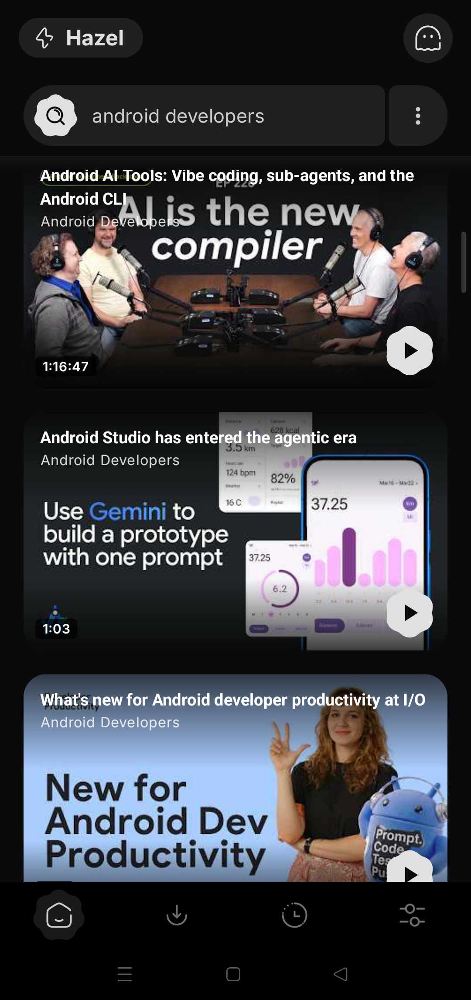<br><b>▶️ 搜尋與播放</b></td>
    <td align="center" width="25%"><br><b>📚 全部下載</b></td>
    <td align="center" width="25%">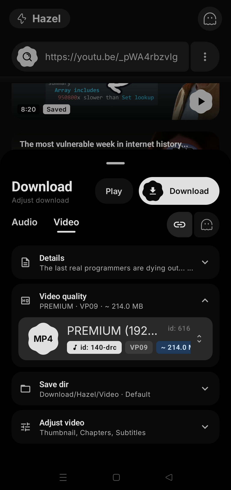<br><b>🎬 下載選項</b></td>
    <td align="center" width="25%">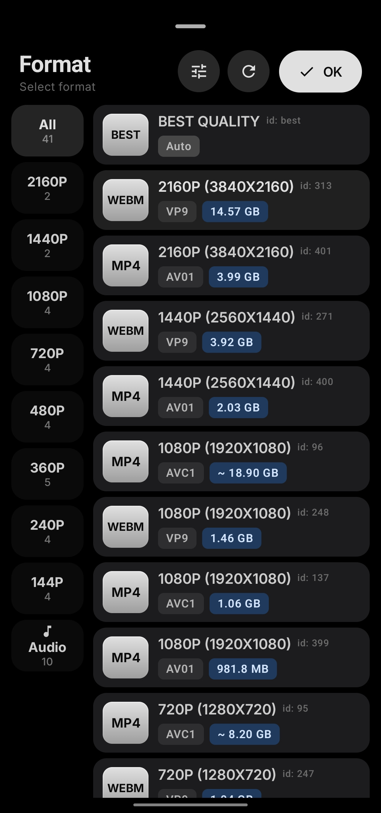<br><b>🎚️ 格式選擇</b></td>
  </tr>
  <tr>
    <td align="center" width="25%">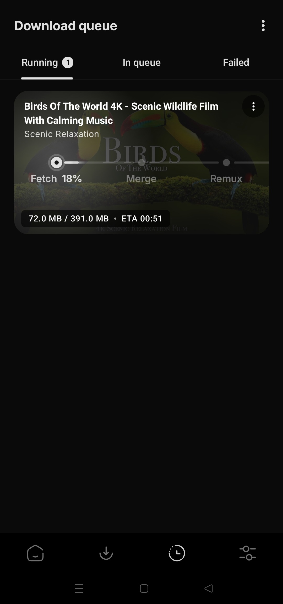<br><b>⏳ 下載佇列</b></td>
    <td align="center" width="25%">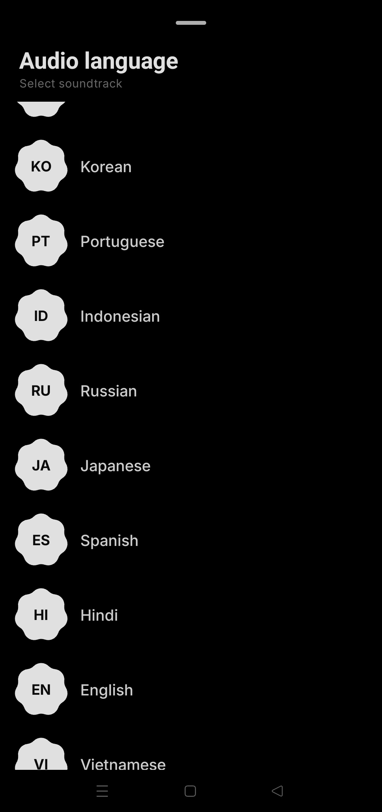<br><b>🌐 音訊語言</b></td>
    <td align="center" width="25%">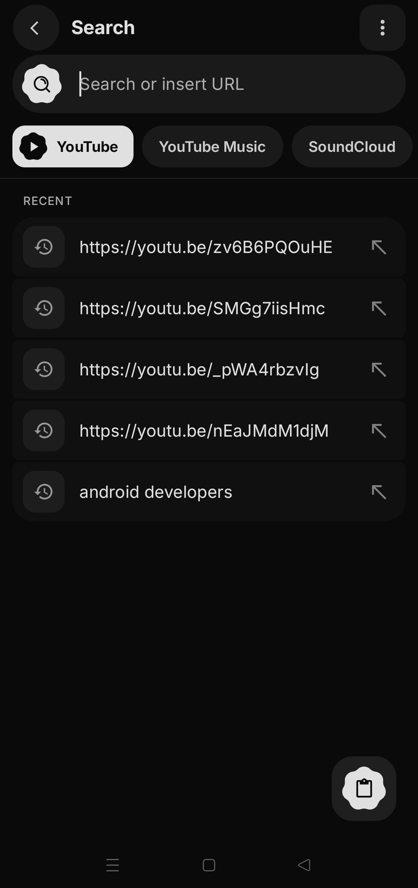<br><b>🔍 智慧搜尋</b></td>
    <td align="center" width="25%">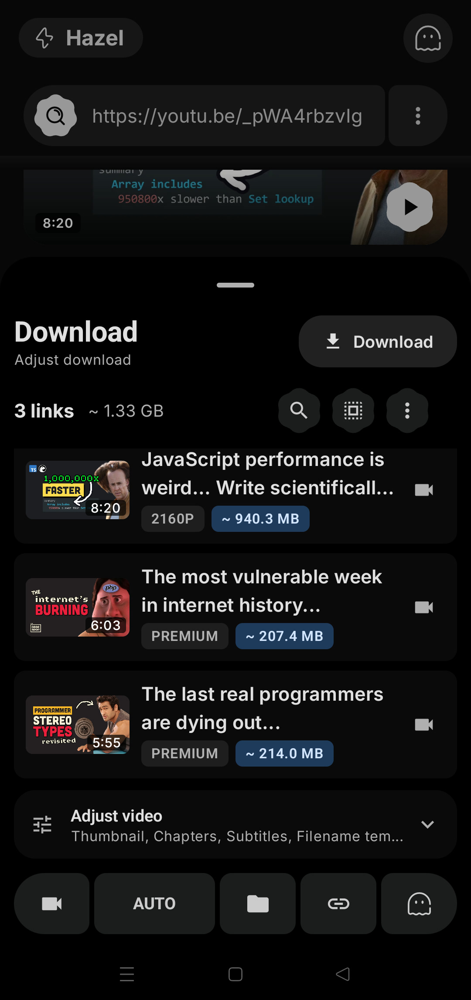<br><b>📃 播放清單批次</b></td>
  </tr>
  <tr>
    <td align="center" width="25%">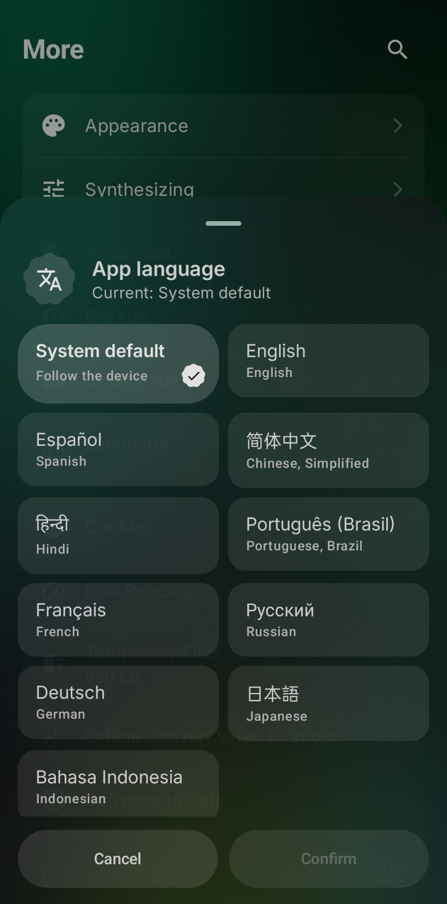<br><b>🗣️ App 語言</b></td>
    <td align="center" width="25%">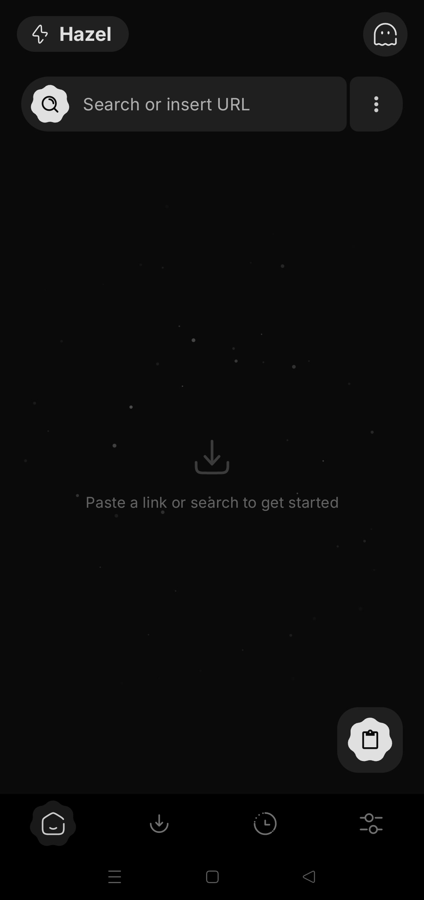<br><b>✨ 玻璃首頁</b></td>
    <td align="center" width="25%">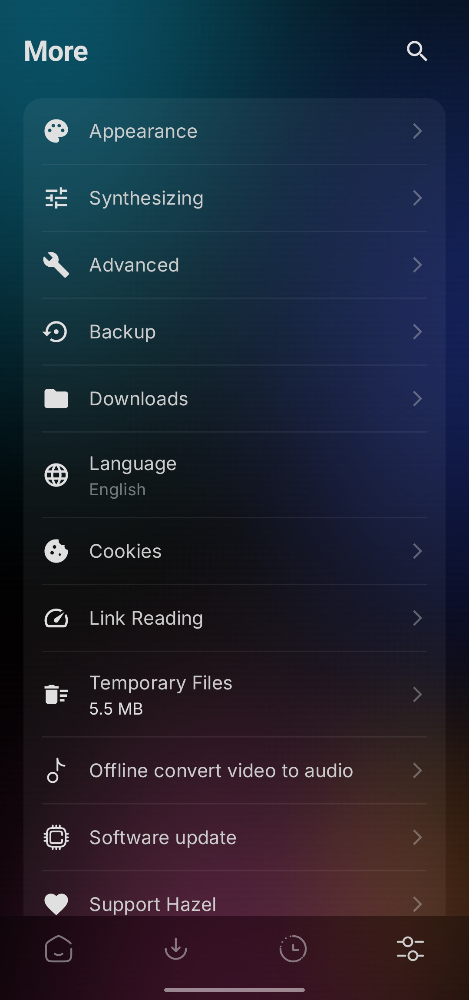<br><b>⚙️ 更多設定</b></td>
    <td align="center" width="25%">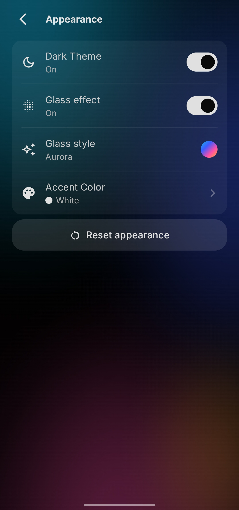<br><b>🎨 外觀</b></td>
  </tr>
</table>

---
## ⬇️ 下載與安裝

選擇你偏好的來源取得最新版 Hazel：

> **系統需求：** Android 7.0+（API 24）• 2GB 記憶體（建議 3GB+）• 下載約 75MB，設定完成後約需 300MB 可用空間

<table align="center">
  <tr><th>來源</th><th>徽章</th><th>說明</th></tr>
  <tr>
    <td><b>GitHub</b></td>
    <td align="center"><a href="https://github.com/SibtainOcn/Hazel/releases/latest"></a></td>
    <td>直接下載 APK，含 App 內更新</td>
  </tr>
  <tr>
    <td><b>F-Droid</b></td>
    <td align="center"><a href="https://f-droid.org/packages/com.hazel.android/"></a></td>
    <td>官方儲存庫，由 F-Droid 負責更新</td>
  </tr>
  <tr>
    <td><b>Obtainium</b></td>
    <td align="center"><a href="https://apps.obtainium.imranr.dev/redirect?r=obtainium://add/https://github.com/SibtainOcn/Hazel"></a></td>
    <td>直接從 GitHub 自動更新</td>
  </tr>
  <tr>
    <td><b>OpenAPK</b></td>
    <td align="center"><a href="https://www.openapk.net/hazel/com.hazel.android/"></a></td>
    <td>備用 APK 來源</td>
  </tr>
</table>

> [!Tip]
>
> **不確定選哪個 APK？** 大多數裝置是 **arm64-v8a**。如果不確定，請下載 **universal** 版本，所有裝置都能用。
> GitHub 版 APK 帶有 App 內更新，無需造訪發布頁即可偵測並下載新版本。F-Droid 版 APK 沒有，因為更新由 F-Droid 自行處理。
> 想知道有什麼新內容？閱讀[更新說明](https://sibtainocn.github.io/Hazel/hazel/whats-new.html)或[安裝指南](https://sibtainocn.github.io/Hazel/hazel/guide.html#install)。

### 🔗 與第三方 App 連動
App 套件名稱為 `com.hazel.android`。可用它將 Hazel 與自動化工具、啟動器或其他 App 連結。

### ✅ 驗證應用程式簽章
Hazel 正式版建置可重現，並使用下方的開發者憑證簽署。如果你的 APK 簽章不同，表示它已被第三方修改，請勿安裝。

```text
Owner (DN): CN=sibtainocn
SHA-256:    0377e9c8352c017e42583cea1715c40c400a51c4045c268825ffc9bae1305c86
SHA-1:      d5c4a6a86d3cde1c1c722564f1efaf8893ea85a2
MD5:        3bcce9e14c616a9087766563875978e6
```
[](https://www.star-history.com/#SibtainOcn/Hazel&Date)
## 🤝 參與貢獻

歡迎貢獻！請參閱我們的 [CONTRIBUTING.md](https://github.com/SibtainOcn/Hazel/blob/main/CONTRIBUTING.md) 了解指南。

- 📖 **需要幫助？** [閱讀 Wiki](https://github.com/SibtainOcn/Hazel/wiki)
- 🐞 **發現 Bug？** [提交 issue](https://github.com/SibtainOcn/Hazel/issues/new/choose)
- 💡 **有想法？** [請求新功能](https://github.com/SibtainOcn/Hazel/issues/new/choose)

[GNU GPL v3.0 or later](https://github.com/SibtainOcn/Hazel/blob/main/LICENSE) &nbsp;·&nbsp; `SPDX-License-Identifier: GPL-3.0-or-later`

## 🏆 致謝
**開發者與架構師:** [SibtainOcn](https://github.com/SibtainOcn)

**特別感謝:**
* [linsui](https://github.com/linsui) & [Licaon_Kter](https://github.com/licaon-kter) - F-Droid 儲存庫管理
* [yt-dlp](https://github.com/yt-dlp/yt-dlp) - Hazel 背後強大的下載引擎
* [youtubedl-android](https://github.com/yausername/youtubedl-android) - Android 版 yt-dlp 綁定
* [NewPipeExtractor](https://github.com/TeamNewPipe/NewPipeExtractor) - 快速的清單、搜尋與播放串流
* [Media3 ExoPlayer](https://github.com/androidx/media) - 流暢的 App 內播放

---

<h2 align="center">由 SibtainOcn 用 ❤️ 打造</h2>

<p align="center">
  <b>授權條款:</b> <a href="https://github.com/SibtainOcn/Hazel/blob/main/LICENSE">GNU General Public License v3.0</a>
</p>

<p align="center">© 2026 SibtainOcn。依 GPL-3.0-or-later 授權。</p>

<h3 align="center">⭐ 如果 Hazel 讓你的下載更輕鬆，別忘了給儲存庫按個 Star！ ⭐</h3>
